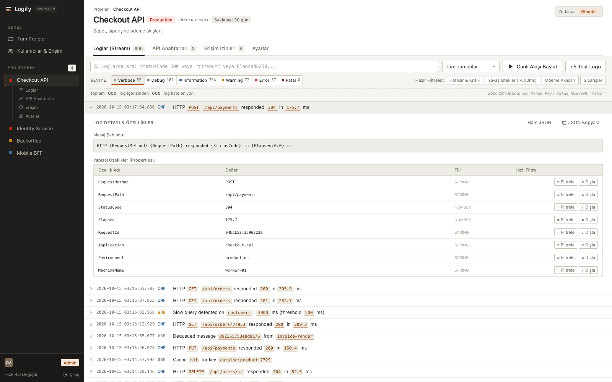

# Logify

**English** · [Türkçe](README.tr.md)

A developer-focused structured log viewer and project management demo, inspired by Seq. Explore project-specific log streams, inspect event properties, and try user roles in a compact web interface.



*Checkout API with sample logs and an expanded event. The current interface is in Turkish; documentation is available in English and Turkish.*

## Project status

The web UI is a standalone, client-side demo with seeded data and simulated log streams. It does not call the backend. Projects, users, permissions, and API keys are managed in memory and reset on page reload; only the selected session user is kept in `sessionStorage`.

`web-api` contains an initial FastAPI application, configuration, and a user model. Log ingestion, persistent storage, and production authentication are not implemented yet. Demo roles and keys illustrate the intended workflows.

## Features

- Separate log streams per project, with environment and retention settings.
- Structured message templates, severity/time filters, and text/property search.
- Expandable event details, exception traces, raw JSON, and copy actions.
- Simulated live tailing and one-click generation of five test events.
- Project creation, settings, user management, and `maintainer` / `viewer` permissions.
- API key management demo: `ingest` / `read` scopes, expiration, revocation, and one-time secret display.
- Quick profile switching to explore administrator and member views.

## Run the web demo

Requirements: Node.js 18+ (compatible with Vite 5) and npm.

```bash
cd web-ui
npm ci
npm run dev
```

Open the local URL printed by Vite (normally `http://localhost:5173`). The API and a database are not required.

Sign in with **`omer@logify.dev`** and password **`logify`**, or choose an active profile under **Hızlı Giriş**. Open **Checkout API** to explore its log stream. Select a log row to inspect properties. Use **Canlı Akışı Başlat** or **+5 Test Logu** to generate more events.

### Build and check

Run these commands from `web-ui`:

```bash
npm run typecheck  # TypeScript checks
npm run build      # TypeScript checks + production build in dist/
npm run preview    # Serve the production build locally
```

## Search examples

| Query | Meaning |
| --- | --- |
| `timeout` | Search message text and exception traces. |
| `StatusCode=500` | Match a property value (`StatusCode:500` also works). |
| `StatusCode!=200` | Exclude a property value. |
| `Elapsed>250` | Match a numeric comparison. |
| `Elapsed<=100` | Match an upper numeric bound. |

Use **= Filtrele** or **≠ Dışla** in an event's property table to append a filter to the query.

## Repository layout

```text
logify/
├── README.md           # English documentation
├── README.tr.md        # Turkish documentation
├── docs/images/        # Demo screenshot
├── web-ui/             # React + TypeScript + Vite demo
│   └── src/
│       ├── components/ # Atoms, molecules, organisms, templates
│       ├── pages/      # Login, projects, events, keys, access, settings, users
│       ├── data/       # Seed data and log generator
│       ├── store/      # In-memory state and actions
│       └── lib/        # Query parsing, permissions, formatting, secrets
└── web-api/            # Python / FastAPI backend scaffold
```

## Backend development

The backend requires **Python 3.14+** and uses FastAPI, SQLModel, Pydantic, and Uvicorn. With uv installed, run it separately:

```bash
cd web-api
uv sync
uv run uvicorn web_api:app --host 127.0.0.1 --port 8000 --reload
```

FastAPI documentation is available at `http://127.0.0.1:8000/docs`. The application currently has no custom API routes and is not connected to the UI.
